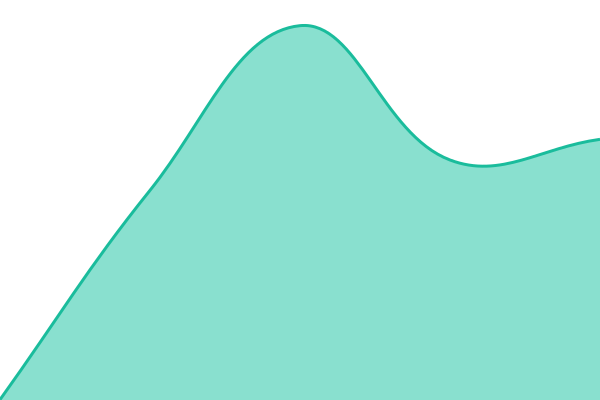

# [📈 Live Status](https://NEXT-Society.github.io/next.status): <!--live status--> **🟩 All systems operational**

This repository contains the open-source uptime monitor and status page for [NEXT Society](https://NEXT-Society.github.io/next.status), powered by [Upptime](https://github.com/upptime/upptime).

### Server health

Live values from [`next.ieb.net/status/metrics.json`](https://next.ieb.net/status/metrics.json), written every minute on the server
([next.infra](https://github.com/NEXT-Society/next.infra), role `status`). Thresholds are evaluated there; anything but `OK` marks _Server health_ down.
Badges are cached for up to 5 minutes.

With [Upptime](https://upptime.js.org), you can get your own unlimited and free uptime monitor and status page, powered entirely by a GitHub repository. We use [Issues](https://github.com/NEXT-Society/next.status/issues) as incident reports, [Actions](https://github.com/NEXT-Society/next.status/actions) as uptime monitors, and [Pages](https://NEXT-Society.github.io/next.status) for the status page.

<!--start: status pages-->
<!-- This summary is generated by Upptime (https://github.com/upptime/upptime) -->
<!-- Do not edit this manually, your changes will be overwritten -->
<!-- prettier-ignore -->
| URL | Status | History | Response Time | Uptime |
| --- | ------ | ------- | ------------- | ------ |
|  [Wiki](https://next.ieb.net/s/society) | 🟩 Up | [wiki.yml](https://github.com/NEXT-Society/next.status/commits/HEAD/history/wiki.yml) | 

 642ms
     
 | 

<a href="https://NEXT-Society.github.io/next.status/history/wiki">99.18%</a>
    

|  [Landing page](https://nextsociety.ieb.net/) | 🟩 Up | [landing-page.yml](https://github.com/NEXT-Society/next.status/commits/HEAD/history/landing-page.yml) | 

 814ms
     
 | 

<a href="https://NEXT-Society.github.io/next.status/history/landing-page">100.00%</a>
    

|  [Server health](https://next.ieb.net/status/metrics.json) | 🟩 Up | [server-health.yml](https://github.com/NEXT-Society/next.status/commits/HEAD/history/server-health.yml) | 

 538ms
     
 | 

<a href="https://NEXT-Society.github.io/next.status/history/server-health">100.00%</a>
    

<!--end: status pages-->

[**Visit our status website →**](https://NEXT-Society.github.io/next.status)

## 📄 License

- Powered by: [Upptime](https://github.com/upptime/upptime)
- Code: [MIT](./LICENSE) © [Anand Chowdhary](https://anandchowdhary.com)
- Data in the `./history` directory: [Open Database License](https://opendatacommons.org/licenses/odbl/1-0/)
